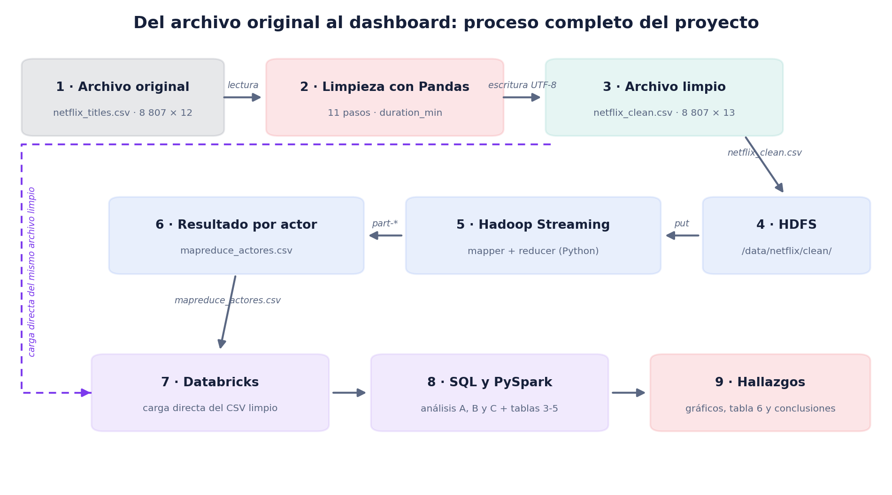
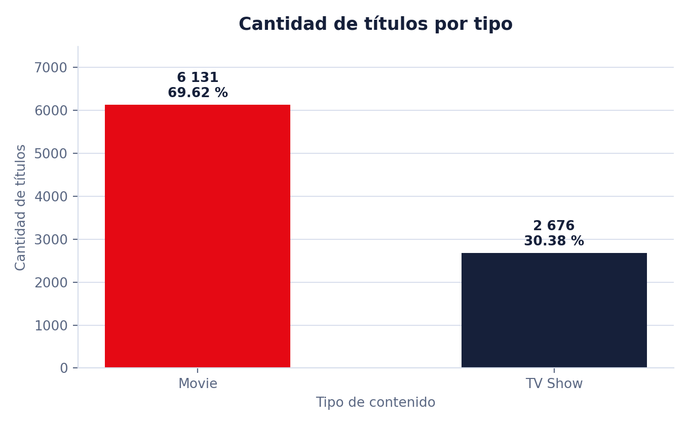
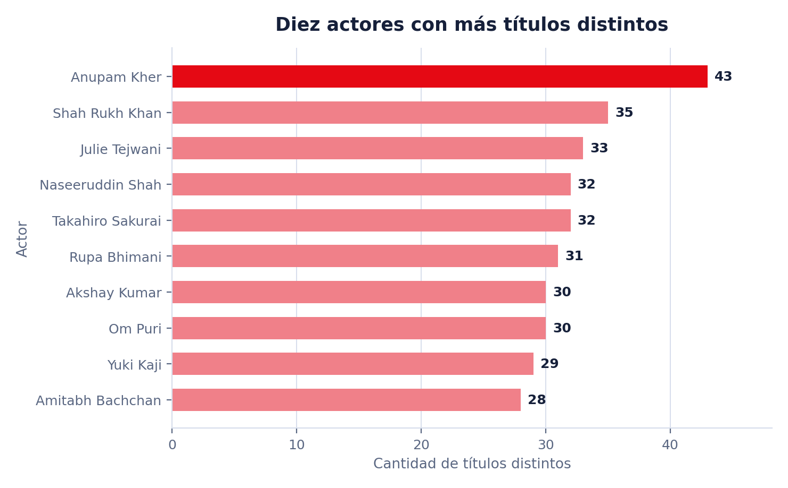

# Análisis del catálogo de Netflix

## Limpieza con Pandas, conteo con Hadoop MapReduce y verificación con Spark en Databricks

**Informe · Evaluación Segundo Momento**

| | |
|---|---|
| **Asignatura** | Tecnologías Emergentes I |
| **Equipo** | Elsner |
| **Integrantes** | Jhael Arguedas · Carlos Conde · Bryan Mamani |
| **Fecha de exposición** | lunes 16 de noviembre de 2026 |
| **Conjunto de datos** | Netflix Movies and TV Shows (Kaggle) · 8 807 títulos |
| **Proyecto** | `proyecto_netflix_elsner` |

> Documento generado a partir de los resultados reales del pipeline. Las cifras provienen de `datos/resultados/` y del notebook `03_analisis_netflix.ipynb`.

---

## 1. Objetivo y proceso

El objetivo del trabajo es recorrer el ciclo completo de un proyecto de Big Data sobre el catálogo público de Netflix: partir del archivo original, dejarlo utilizable, contar los títulos por actor con Hadoop, resolver tres análisis con SQL y PySpark en Databricks y comunicar los hallazgos en un dashboard profesional. El informe responde tres preguntas sobre el catálogo: cuántas películas y series contiene, qué actor participa en más títulos distintos y cómo varía la duración promedio de las películas según el país. Además, comprueba que los tres caminos de cálculo usados (Pandas, Hadoop y Spark) producen los mismos números.

El conjunto de datos es **Netflix Movies and TV Shows**, publicado en Kaggle: 8 807 títulos y 12 columnas, entre ellas `type`, `title`, `cast`, `country`, `date_added` y `duration`. El archivo se conserva intacto en `datos/raw/netflix_titles.csv`; todas las etapas posteriores usan el archivo limpio `datos/clean/netflix_clean.csv`.

### 1.1 Etapas ejecutadas

1. **Reto 1 · Limpieza con Pandas.** Once pasos ordenados sobre el archivo original para producir `netflix_clean.csv`, con la columna numérica `duration_min` y las fechas en formato dd/mm/aaaa.
2. **Reto 2 · Conteo con Hadoop.** Carga del archivo limpio en HDFS y trabajo de Hadoop Streaming con un mapper y un reducer en Python que cuentan títulos distintos por actor.
3. **Reto 3 · Análisis en Databricks.** Carga de ambos CSV como tablas de Unity Catalog, resolución de tres análisis en SQL y en PySpark, comparación de las salidas y verificación contra la salida de Hadoop.
4. **Reto 4 · Hallazgos.** Dos gráficos, la tabla de duración por país y las conclusiones, presentados en el notebook y en el dashboard del proyecto.



*Figura 1. Proceso completo, desde el archivo original hasta el dashboard.*

La Figura 1 muestra el recorrido y los archivos que se transfieren en cada flecha. El archivo original se limpia una sola vez; el resultado se usa por dos caminos independientes. El primero lo lleva a HDFS (`put`), ejecuta mapper y reducer y produce `mapreduce_actores.csv`. El segundo lo sube directamente a un volumen de Databricks, donde se analiza con SQL y PySpark. La comparación final cruza las tres salidas y alimenta el dashboard y este informe.

### 1.2 Síntesis de resultados

| Indicador | Resultado |
|---|---|
| Títulos en el archivo limpio | 8 807 |
| Películas / series | 6 131 / 2 676 |
| Actores distintos (MapReduce y Spark) | 36 439 |
| Países distintos en el cálculo de duración | 117 |
| Diferencias entre SQL y PySpark | 0 |
| Diferencias entre MapReduce y Spark | 0 |

## 2. Reto 1 · Limpieza y Tabla 1

El programa `scripts/01_limpiar_netflix.py` aplica, en este orden, las reglas del enunciado. El orden importa: primero se normaliza el texto y después se eliminan duplicados, de modo que dos filas que solo difieren en espacios se detectan como iguales.

1. Eliminar espacios al inicio y al final de todos los campos de texto.
2. Sustituir saltos de línea y tabulaciones por espacios.
3. Convertir los textos vacíos en valores nulos.
4. Eliminar las filas completamente duplicadas.
5. Eliminar los registros sin `show_id`.
6. Si un `show_id` se repite, conservar la primera aparición.
7. Convertir `date_added` a dd/mm/aaaa; si no se puede interpretar, dejar vacío.
8. Crear `duration_min` solo para `type = 'Movie'`, con los minutos como número entero.
9. Conservar las 12 columnas originales y agregar `duration_min` al final.
10. Mantener los datos desconocidos como nulos, sin imputar valores.
11. Guardar en UTF-8, con cabecera, separado por comas y sin índice.

**Tabla 1. Resultado de la limpieza**

| Indicador | Cantidad |
|---|---|
| Registros del archivo original, sin cabecera | 8 807 |
| Columnas del archivo original | 12 |
| Filas completamente duplicadas eliminadas | 0 |
| Registros sin show_id eliminados después de retirar duplicados | 0 |
| Registros con show_id repetido eliminados posteriormente | 0 |
| Registros del archivo limpio | 8 807 |
| Películas con duration_min numérica mayor que cero | 6 128 |
| Películas sin una duración numérica mayor que cero | 3 |

La Tabla 1 coincide exactamente con la referencia del enunciado. No hubo filas duplicadas ni identificadores repetidos, por lo que el archivo limpio conserva los 8 807 títulos y solo agrega una columna. De las 6 131 películas, 6 128 tienen una duración numérica; las tres restantes son especiales de Louis C. K. cuyo campo `duration` viene vacío en el archivo original. Se conservan como nulos: inventar una duración alteraría los promedios. La Tabla A.1 del Anexo A detalla cuántos nulos conserva cada columna.

## 3. Reto 2 · MapReduce y Tabla 2

El archivo limpio se cargó en HDFS en `/data/netflix/clean/netflix_clean.csv` y se verificó con `hdfs dfs -ls -h`. El trabajo se ejecutó con **Hadoop Streaming 3.3.6** y un solo reducer, de modo que la salida queda ordenada por actor y la comparación posterior es directa. Los programas son `scripts/02_mapper_actores.py` y `scripts/02_reducer_actores.py`, escritos solo con la biblioteca estándar de Python.

- El **mapper** omite la cabecera, interpreta cada fila con el módulo `csv`, separa `cast` por comas, recorta los espacios y emite un par `actor<TAB>show_id` por cada nombre no vacío.
- El **reducer** recibe los pares agrupados por Hadoop, acumula los `show_id` en un conjunto y emite `actor<TAB>cantidad_titulos`. Un mismo título se cuenta una sola vez por actor.
- La escritura conserva tildes y mayúsculas; no se normalizan los nombres para no unir personas distintas.

```text
hadoop jar $HADOOP_HOME/share/hadoop/tools/lib/hadoop-streaming-3.3.6.jar \
  -D mapreduce.job.name="netflix_actores" \
  -D mapreduce.job.reduces=1 \
  -files 02_mapper_actores.py,02_reducer_actores.py \
  -mapper "python3 02_mapper_actores.py" \
  -reducer "python3 02_reducer_actores.py" \
  -input /data/netflix/clean/netflix_clean.csv \
  -output /data/netflix/results/actores/
```

El mapper emitió **64 126 pares actor–show_id**. El reducer produjo **36 439 actores distintos**, cifra que se conserva en `mapreduce_actores.csv` después de reunir las partes con `scripts/02_exportar_resultado.py`. El total de pares es mayor que el de actores porque cada intérprete participa en varios títulos.

**Tabla 2. Resultado de MapReduce (diez primeros actores)**

| Posición | Actor | Cantidad de títulos distintos |
|---|---|---|
| 1 | Anupam Kher | 43 |
| 2 | Shah Rukh Khan | 35 |
| 3 | Julie Tejwani | 33 |
| 4 | Naseeruddin Shah | 32 |
| 5 | Takahiro Sakurai | 32 |
| 6 | Rupa Bhimani | 31 |
| 7 | Akshay Kumar | 30 |
| 8 | Om Puri | 30 |
| 9 | Yuki Kaji | 29 |
| 10 | Amitabh Bachchan | 28 |

Los empates se resuelven por nombre ascendente: Naseeruddin Shah aparece antes que Takahiro Sakurai, ambos con 32 títulos. La Tabla 2 se reproduce igual desde MapReduce y desde Spark, como se comprueba en el Reto 3.

> **Evidencia 1 · Carga del archivo limpio en HDFS.** Captura de los comandos `hdfs dfs -put` y `hdfs dfs -ls -h /data/netflix/clean/`, con el nombre y el tamaño del archivo visibles.

> **Evidencia 2 · Finalización correcta del trabajo MapReduce.** Captura de la consola con `map 100%`, `reduce 100%` y `Job ... completed successfully`.

## 4. Reto 3 · Análisis y verificación en Databricks

El notebook `databricks/03_analisis_netflix.ipynb` carga los dos CSV en un volumen de Unity Catalog y crea las tablas **workspace.netflix.netflix_clean** (8 807 filas y 13 columnas) y **workspace.netflix.mapreduce_actores** (36 439 filas). La primera sección declara catálogo, esquema y nombres completos, y comprueba que las cabeceras se interpretan como columnas, que los campos con comas se leen correctamente y que los conteos coinciden con la Tabla 1 y con el CSV exportado de Hadoop.

- `netflix_clean`: 8 807 registros y 8 807 `show_id` distintos.
- `mapreduce_actores`: 36 439 actores, igual que las filas del CSV exportado.
- Se muestran cinco registros de cada tabla y el esquema resultante.
- La lectura usa `multiLine = true` porque `description` contiene comas y comillas.

### 4.1 Los tres análisis, resueltos dos veces

Cada análisis tiene una celda SQL y una celda PySpark independientes. Las soluciones no reutilizan el resultado de la otra: solo comparten la tabla de entrada y las reglas.

- **A · Películas y series.** Se clasifica cada título con `CASE` (`Movie`, `TV Show`, «Sin clasificación» u «Otro») y se cuenta `show_id` distinto por tipo. Resultado: 6 131 películas y 2 676 series.
- **B · Títulos por actor.** Se separa `cast` por comas, se recorta cada nombre, se descartan los vacíos y se eliminan los pares repetidos `(show_id, actor)` antes de contar. Resultado: 36 439 actores.
- **C · Duración promedio por país.** Solo películas con `duration_min` numérico y mayor que cero. Se separa `country` por comas, se cuenta cada película una vez por país y se calcula `ROUND(AVG(duration_min), 2)`. Resultado: 117 países.

La comparación une las dos salidas por su clave (`tipo`, `actor` o `pais`) con un **full outer join** y clasifica cada fila como igual, diferente o presente en una sola salida. Para los promedios se admite una tolerancia de 0,01 minutos, equivalente a comparar los valores redondeados a dos decimales.

**Tabla 3. Verificación de SQL y PySpark**

| Análisis | Filas SQL | Filas PySpark | Valores diferentes | En una sola salida | ¿Coinciden? |
|---|---|---|---|---|---|
| Películas y series | 2 | 2 | 0 | 0 | Sí |
| Títulos por actor | 36 439 | 36 439 | 0 | 0 | Sí |
| Duración por país | 117 | 117 | 0 | 0 | Sí |

Las seis soluciones producen exactamente las mismas filas. Esta coincidencia no es trivial: obliga a que la separación de valores multivaluados, el recorte de espacios y el redondeo se comporten igual en Spark SQL y en la API de DataFrames. En Spark SQL, `cast` es una palabra reservada y debe escribirse entre backticks; es el error más frecuente al replicar la consulta.

### 4.2 MapReduce contra Spark

La Tabla 4 toma los diez primeros actores del resultado de Spark, ordenados por cantidad descendente y nombre ascendente, y busca a la misma persona en la salida de Hadoop. La diferencia se calcula como MapReduce menos Spark. La Tabla 5 extiende la comparación a los 36 439 actores con un full outer join.

**Tabla 4. Comparación de los diez primeros actores**

| Actor | Cantidad en MapReduce | Cantidad en Spark | Diferencia |
|---|---|---|---|
| Anupam Kher | 43 | 43 | 0 |
| Shah Rukh Khan | 35 | 35 | 0 |
| Julie Tejwani | 33 | 33 | 0 |
| Naseeruddin Shah | 32 | 32 | 0 |
| Takahiro Sakurai | 32 | 32 | 0 |
| Rupa Bhimani | 31 | 31 | 0 |
| Akshay Kumar | 30 | 30 | 0 |
| Om Puri | 30 | 30 | 0 |
| Yuki Kaji | 29 | 29 | 0 |
| Amitabh Bachchan | 28 | 28 | 0 |

**Tabla 5. Verificación completa de MapReduce y Spark**

| Indicador | Cantidad |
|---|---|
| Actores en MapReduce | 36 439 |
| Actores en Spark | 36 439 |
| Presentes en ambas salidas con cantidades iguales | 36 439 |
| Presentes en ambas salidas con cantidades diferentes | 0 |
| Presentes únicamente en MapReduce | 0 |
| Presentes únicamente en Spark | 0 |

La coincidencia es total. Hadoop y Spark parten del mismo archivo y aplican las mismas reglas, pero lo hacen con implementaciones distintas: el reducer acumula en memoria los identificadores de un actor, mientras que Spark distribuye la agregación y usa `countDistinct`. Que ambos lleguen a 36 439 actores y a las mismas cantidades respalda la correctitud del mapper, del reducer y de la lectura del CSV.

> **Evidencia 3 · Tablas cargadas en Databricks.** Captura de `netflix_clean` y `mapreduce_actores` en Catalog, con el conteo de filas y cinco registros visibles.

> **Evidencia 4 · Tabla 3 completa en el notebook.** Captura de las tres filas con «Sí» en la columna de coincidencia.

> **Evidencia 5 · Tablas 4 y 5 en el notebook.** Captura de la comparación de los diez actores y del resumen de los 36 439.

## 5. Reto 4 · Hallazgos

Los dos gráficos y la tabla se construyen con los resultados PySpark del Reto 3, dentro del mismo notebook, y se replican en el dashboard del proyecto. Los rankings resuelven los empates por nombre ascendente y todos los ejes están rotulados.



*Figura 2. Cantidad de títulos por tipo, con cantidad y porcentaje sobre cada barra.*

El catálogo es mayoritariamente cinematográfico: **6 131 películas (69,62 %)** frente a **2 676 series (30,38 %)**. Los porcentajes se calculan sobre los 8 807 títulos clasificados como Movie o TV Show; no hay registros con otro tipo ni sin clasificación.



*Figura 3. Diez actores con mayor cantidad de títulos distintos.*

**Anupam Kher** encabeza el ranking con **43 títulos distintos**, seguido por Shah Rukh Khan (35) y Julie Tejwani (33). La concentración es alta en la cabeza y cae rápido: el décimo actor, Amitabh Bachchan, tiene 28. La mayoría de estos intérpretes pertenece a la industria de la India, el segundo país con más películas del catálogo.

**Tabla 6. Duración de películas por país (diez primeros)**

| País | Películas utilizadas | Duración promedio (min) |
|---|---|---|
| United States | 2 749 | 93,75 |
| India | 962 | 125,91 |
| United Kingdom | 534 | 98,76 |
| Canada | 319 | 91,15 |
| France | 303 | 100,97 |
| Germany | 182 | 103,01 |
| Spain | 171 | 101,10 |
| Japan | 119 | 98,85 |
| China | 114 | 104,46 |
| Mexico | 111 | 90,60 |

Estados Unidos concentra 2 749 películas, casi la mitad de las 5 688 que entran al cálculo, con un promedio de 93,75 minutos. India, con 962 películas, tiene el promedio más alto del grupo líder: **125,91 minutos**, más de dos horas. En el extremo opuesto, México promedia 90,60 minutos. La duración no depende del volumen: países con pocas películas pueden tener promedios altos o bajos.

### 5.1 Conclusiones

> El catálogo analizado contiene 8 807 títulos: 6 131 películas (69,62 %) y 2 676 series (30,38 %). El actor con más títulos distintos es Anupam Kher, con 43. Sobre la duración, Estados Unidos aporta 2 749 películas al cálculo con un promedio de 93,75 minutos, mientras que India registra el promedio más alto del grupo líder (125,91 minutos). Los tres análisis produjeron exactamente las mismas salidas en SQL y en PySpark: 2 filas en el análisis de tipos, 36 439 actores y 117 países. El conteo de MapReduce coincidió con Spark en 36 439 actores, con 0 diferencias y 0 nombres presentes en una sola salida. Por último, los campos cast y country son multivaluados: un título cuenta para cada actor o país que lo acompaña y los vacíos se mantienen nulos, de modo que estos resultados describen la composición del catálogo y no la audiencia ni el éxito comercial de los títulos.

*Extensión: 148 palabras (límite 250). Las cifras se refieren únicamente al catálogo analizado; no se atribuyen a preferencias de usuarios, audiencia ni éxito comercial.*

### 5.2 Limitaciones de los datos

- **Valores multivaluados.** `cast` y `country` contienen varios valores por título. Un actor o un país suma un título completo, sin repartir el crédito entre participantes.
- **Nombres sin normalizar.** Una misma persona puede aparecer con variantes de escritura y contarse como dos actores distintos; no se aplicó reconciliación de identidades.
- **Datos faltantes.** 2 634 títulos no registran director, 831 no registran país, 825 no registran reparto y 3 películas no tienen duración. Esos casos quedan fuera del cálculo correspondiente, no se imputan.
- **Corte temporal.** El archivo es una fotografía del catálogo hasta 2021; no describe la evolución posterior ni el comportamiento de los suscriptores.
- **Promedios simples.** La duración promedio por país no está ponderada por población ni por consumo: solo describe los títulos disponibles.

> **Evidencia 6 · Gráficos y Tabla 6 en el notebook.** Captura de los dos gráficos con título, ejes y etiquetas, y de la tabla de los diez países.

> **Evidencia 7 · Dashboard del proyecto.** Captura de las seis páginas del panel: resumen, limpieza, MapReduce, Databricks, hallazgos y catálogo.

## 6. Referencias

1. Bansal, S. *Netflix Movies and TV Shows* [conjunto de datos]. Kaggle. https://www.kaggle.com/datasets/shivamb/netflix-shows
2. Apache Software Foundation. *Hadoop Streaming*. https://hadoop.apache.org/docs/stable/hadoop-streaming/HadoopStreaming.html
3. Apache Software Foundation. *Spark SQL built-in functions*. https://spark.apache.org/docs/latest/api/sql/index.html
4. Databricks. *Unity Catalog volumes*. https://docs.databricks.com/en/connect/unity-catalog/volumes.html
5. Databricks. *PySpark on Databricks*. https://docs.databricks.com/en/pyspark/index.html
6. Pandas Development Team. *pandas documentation*. https://pandas.pydata.org/docs/
7. FastAPI. *FastAPI documentation*. https://fastapi.tiangolo.com/
8. Bootstrap. *Bootstrap 5.3 documentation*. https://getbootstrap.com/docs/5.3/
9. Chart.js. *Chart.js 4 documentation*. https://www.chartjs.org/docs/latest/

### 6.1 Archivos del trabajo

El proyecto completo está en la carpeta `C:\Users\Jhael\OneDrive\Documentos\Default Project\proyecto_netflix_elsner`. Para la entrega, esa carpeta se publica en un repositorio o en una carpeta compartida; la estructura y el orden de ejecución se detallan en el `README.md` y en el Anexo A.

## Anexo A · Ejecución y entregables

### A.1 Versiones utilizadas

| Herramienta | Versión |
|---|---|
| Python | 3.14.4 |
| pandas | 3.1.1 |
| FastAPI / Uvicorn | 0.162.4 / 0.52.4 |
| Hadoop | 3.3.6 |
| Databricks Runtime | 15.4 LTS (Spark 3.5) |
| Bootstrap / Chart.js | 5.3.3 / 4.4.3 |

### A.2 Estructura y orden de ejecución

```text
proyecto_netflix_elsner/
  datos/raw/netflix_titles.csv        archivo original
  datos/clean/netflix_clean.csv       archivo limpio (8 807 x 13)
  datos/resultados/mapreduce_actores.csv
  scripts/01_limpiar_netflix.py
  scripts/02_mapper_actores.py
  scripts/02_reducer_actores.py
  scripts/02_ejecutar_mapreduce.txt
  scripts/02_exportar_resultado.py
  databricks/03_analisis_netflix.ipynb
  databricks/GUIA_DATABRICKS.md
  hadoop/GUIA_HADOOP.md
  backend/                            API FastAPI
  frontend/                           dashboard Bootstrap
  docs/                               informe, figuras y guion
```

```text
python scripts/00_descargar_dataset.py
python scripts/01_limpiar_netflix.py
python scripts/02_simular_mapreduce_local.py     # ensayo sin Hadoop
python scripts/02_exportar_resultado.py --partes datos/resultados/partes_locales
python scripts/03_generar_resultados.py
python run.py                                    # dashboard en :8000
```

En un clúster real, el tercer paso se reemplaza por el trabajo de Hadoop descrito en `hadoop/GUIA_HADOOP.md`; el resto no cambia. En Databricks se importa el notebook y se ejecuta de principio a fin, como indica `databricks/GUIA_DATABRICKS.md`.

### A.3 Entregables

| Entregable | Archivo |
|---|---|
| Informe PDF | docs/Informe_Netflix_Elsner.pdf |
| Presentación | docs/Presentacion_Netflix_Grupo.pdf |
| Programa de limpieza | scripts/01_limpiar_netflix.py |
| Archivo limpio | datos/clean/netflix_clean.csv |
| Mapper y reducer | scripts/02_mapper_actores.py, 02_reducer_actores.py |
| Comando de MapReduce | scripts/02_ejecutar_mapreduce.txt |
| Resultado de Hadoop | datos/resultados/mapreduce_actores.csv |
| Notebook exportado | databricks/03_analisis_netflix.ipynb |
| Dashboard | backend/ + frontend/ |
| README | README.md |
| Evidencias (capturas) | docs/evidencias/ |

### A.4 Servicios del dashboard

- `GET /api/resumen` — indicadores, tipos, años, ratings y calidad.
- `GET /api/limpieza` — Tabla 1, nulos y muestra del archivo limpio.
- `GET /api/mapreduce` — top de actores y comparación con Spark.
- `GET /api/verificacion` — Tablas 3, 4 y 5.
- `GET /api/actores`, `GET /api/paises`, `GET /api/tipos` — análisis del Reto 3.
- `GET /api/catalogo` — explorador con búsqueda y paginación.
- `GET /export/{recurso}.csv` — descarga de los CSV de resultados.
- `GET /docs` — documentación interactiva de la API.

### A.5 Nulos conservados por columna

Ningún valor desconocido se imputa. La columna `duration_min` queda nula en las series por diseño (solo aplica a películas) y en las tres películas sin duración en el origen.

**Tabla A.1. Nulos conservados en el archivo limpio**

| Columna | Valores nulos | Lectura |
|---|---|---|
| director | 2 634 | No todos los títulos registran dirección |
| cast | 825 | Títulos sin reparto declarado |
| country | 831 | País no informado |
| date_added | 10 | Fecha no interpretable; se deja vacía |
| rating | 4 | Clasificación ausente |
| duration | 3 | Películas sin duración en el origen |
| duration_min | 2 679 | 3 películas sin dato + 2 676 series (por diseño) |

*Documento generado automáticamente con `python docs/generar_informe.py` a partir de los resultados reales del pipeline. Las evidencias 1 a 7 son capturas que el equipo adjunta en la versión final del PDF.*
